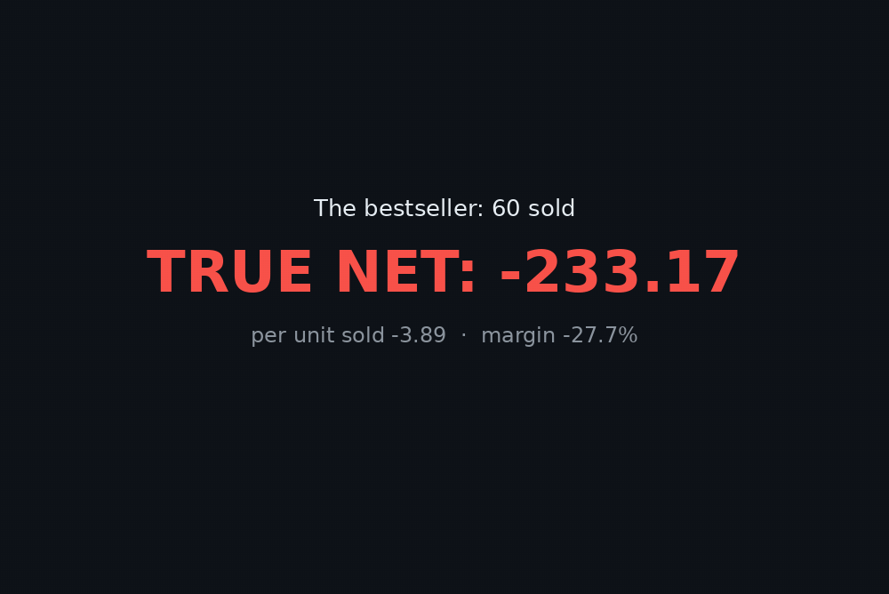

<h1 align="center">seller-profit-truth</h1>

<p align="center"><strong>Your bestseller might be losing money.</strong></p>

<p align="center">
  
  
  
  
  
</p>



<p align="center"><em>Real runs on the bundled sample: the full report, then the break-even solve. The mug sells best and loses most.</em></p>

Your marketplace dashboard shows revenue. It does not show what is left after the listing fee, the transaction fee, the payment processing fee, the offsite-ads fee, the shipping you ate, and the returns. Stacked together on the wrong listing, they take more than the sale was worth.

The sample bundled with this tool proves it. Its best-selling physical product, a ceramic mug with 60 sales, **loses 233.17** once the subtraction is done honestly: 193.87 of fees (100.98 of that offsite ads), 346.80 of materials, and 534.00 of shipping the seller absorbed, against 841.50 of kept gross. SEO tools will happily help you rank that mug higher. This tool tells you whether you should.

`seller-profit-truth` reads a simple file of your listings and sales, then prints — per listing — gross, **every fee line separately**, total costs, true net profit, true margin %, and a **LOSS-MAKER** flag. It also has a break-even mode: the minimum price that *actually* hits your target margin after fees.

## Quick start

```bash
pipx install git+https://github.com/jasveerai88/seller-profit-truth
# or: pip install git+https://github.com/jasveerai88/seller-profit-truth

# from a clone, so the bundled examples are on disk:
seller-profit-truth report examples/sample.json
```

```
4. Ceramic Mug [etsy] — 60 sold, 9 returned, 51 kept  ⚠ LOSS-MAKER
   Gross kept: 841.50 (refunded 148.50)
   Fees: listing 0.20 · transaction 54.70 · processing 37.99 · offsite ads 100.98 = 193.87
   COGS: 346.80 · Shipping cost: 534.00
   TRUE NET: -233.17 (margin -27.7%) · per unit sold -3.89

TOTALS: gross 3,033.50 · fees 485.29 · COGS 698.80 · shipping 835.50 · TRUE NET 1,013.91 (margin 33.4%)
Loss-makers: 1 of 4 listings
(exit code: 1 — one loss-maker found)
```

Then point `report` at your own sales file (JSON or CSV, format below) and `breakeven` at the listing you are about to price. That is the whole workflow: subtract honestly, then price from the truth.

## What it does

| Command | Question it answers | On the bundled sample |
|---|---|---|
| `report` | "What did each listing actually earn?" | Jacket **+222.62** (37.5%) · Candle **+6.06** (1.5%) · Wall Art **+1,018.40** (84.4%) · Mug **−233.17** ⚠ LOSS-MAKER |
| `breakeven` | "What must this cost to truly keep my target margin?" | The candle at 20% target: **17.04** — it currently sells at 14.00 and keeps 1.5% |

**Reference:** [Honest limits](#honest-limits-the-short-version) · [The model](#the-model-the-choices-are-deliberate--and-stated) · [Input format](#input-format) · [Fee defaults](#fee-defaults-encoded-stamped-overridable) · [Usage](#usage) · [Facts this tool relies on](#facts-this-tool-relies-on) · [For agents](#for-agents) · [Real runs](#real-runs-verbatim) · [Tests](#tests) · [Known limits](#known-limits) · [Privacy](#privacy) · [Contributing](#contributing) · [Related](#related)

## Honest limits (the short version)

- **It computes from figures you supply.** Prices, units, returns, shipping costs and COGS come from your file. Wrong inputs produce wrong arithmetic, faithfully computed.
- **Fee rates are encoded defaults, stamped as of 2026-11 — not live facts.** Platforms change their schedules. Every rate can be overridden per run (`--etsy-transaction-pct 7.0` and friends), and the defaults should be checked against the platform's current published policy before you rely on them.
- **Two published wrinkles the defaults simplify — stated, not hidden.** Etsy's Offsite Ads fee is 15% for shops under $10,000 in annual sales and 12% above that threshold; the encoded default is 12%, so smaller shops should run with `--etsy-offsite-ads-pct 15`. Gumroad charges card processing (2.9% + $0.30) *on top of* its 10% + $0.50 on direct sales; the encoded Gumroad default models the platform fee only, so add processing via `--gumroad-pct 12.9 --gumroad-fixed 0.80` if you want it in the number. (Sources: [Facts](#facts-this-tool-relies-on).)
- **Break-even assumes no returns.** For a returns-heavy listing the true break-even price is higher.
- **Taxes are out of scope.** This is contribution profit after platform fees and direct costs, before tax. Gumroad has been merchant of record since 2025-01-01 and handles sales tax itself; Etsy remits in many jurisdictions — neither changes the fee subtraction here, and neither is modelled.
- **Period costs are not allocated.** Shop subscriptions, promoted-listing budgets and other monthly fixed costs are not split across listings; fold them into a listing's costs yourself, or approximate them with a fee override.

## The model (the choices are deliberate — and stated)

- **Kept units** = units sold − returns. A refunded unit hands the price + shipping charged back to the buyer, so it is not revenue.
- **Platform fees are charged on kept units only** (platforms credit their percentage/fixed fees on a refunded sale).
- **Shipping cost is counted on every unit shipped, returns included.** You paid to ship the returned mug; that money is gone.
- **COGS is counted on kept units only** — a returned unit is restocked.
- **Etsy's listing fee is per listing**, charged once per row and owed even at zero sales. Per-unit views amortize it over units sold (`listing_fee / units`).
- **Exit codes carry the verdict:** `0` = no loss-makers, `1` = at least one loss-maker found, `2` = error. A script or agent can catch a bleeding catalogue without parsing prose.

## Input format

One row per listing, as JSON (a list, or an object with a `"listings"` key) or as CSV with the same headers:

| Field | Required | Meaning |
|---|---|---|
| `name` | yes | listing name |
| `platform` | yes | `etsy` or `gumroad` |
| `price` | yes | sale price per unit, excluding shipping |
| `units` | yes | units sold (whole number, ≥ 0) |
| `shipping_charged` | no (0) | shipping charged to the buyer, per unit |
| `shipping_cost` | no (0) | what *you* pay to ship, per unit |
| `cogs` | no (0) | materials / cost of goods, per unit |
| `returns` | no (0) | units returned (must be ≤ `units`) |
| `offsite_ads` | no (false) | Etsy only: this listing ran offsite ads |

Bad rows are rejected with the row number named — no silent zeros, no tracebacks.

## Fee defaults (encoded, stamped, overridable)

These are the tool's encoded starting points, stamped **as of 2026-11** in the code, in every report header, and here. They are defaults, **not live facts** — platforms change them, and every rate can be overridden per run with the flags under [Usage](#usage).

| Platform | Fee | Encoded default |
|---|---|---|
| Etsy | Listing fee | $0.20 per listing |
| Etsy | Transaction fee | 6.5% of (price + shipping charged) |
| Etsy | Payment processing | 3% + $0.25 of (price + shipping charged) — the US Etsy Payments rate; it varies by country |
| Etsy | Offsite ads (opt-in per listing) | 12% of (price + shipping charged) — see the 15% tier note under [Honest limits](#honest-limits-the-short-version) |
| Gumroad | Platform fee | 10% + $0.50 per transaction, on (price + shipping charged) — platform fee only; processing is separate, see [Honest limits](#honest-limits-the-short-version) |

## Usage

```bash
# 1. The profit report (JSON or CSV input)
seller-profit-truth report examples/sample.json
seller-profit-truth report examples/sample.csv

# 2. The same numbers as one JSON object (for scripts and agents)
seller-profit-truth report examples/sample.json --json

# 3. Also print INR equivalents (rate per 1 unit of your currency)
seller-profit-truth report examples/sample.json --cad-to-inr 67.97

# 4. Override a fee rate when the platform changes it
seller-profit-truth report examples/sample.json --etsy-transaction-pct 7.0

# 5. Break-even: what must the candle cost to truly keep 20%?
seller-profit-truth breakeven --platform etsy \
    --shipping-cost 6.25 --cogs 5.50 --target-margin 20 --units 30
```

Fee override flags (both commands): `--etsy-listing-fee`, `--etsy-transaction-pct`, `--etsy-processing-pct`, `--etsy-processing-fixed`, `--etsy-offsite-ads-pct`, `--gumroad-pct`, `--gumroad-fixed`.

Break-even assumes no returns and amortizes the Etsy listing fee over `--units` expected sales. The solved price is rounded **up** to the next cent, so the price you actually type into the listing still hits the target. If fees + target ≥ 100%, the tool says the target is unreachable and shows you the fee take instead of inventing a price.

From a checkout, with no install: `python3 src/seller_profit_truth.py report FILE` (Python 3.10+, standard library only).

## Facts this tool relies on

The encoded defaults above, checked **2026-11-04** against the platforms' published schedules (corroborated across current fee guides that cite those pages):

| Fact | Source |
|---|---|
| Etsy listing fee **$0.20** per listing; transaction fee **6.5%** of price + shipping charged (+ gift wrap) | Etsy Fees & Payments Policy — etsy.com/legal/fees |
| Etsy Payments processing **3% + $0.25** for US sellers; the rate varies by the seller's bank country | Etsy payment processing fee schedule — etsy.com |
| Etsy Offsite Ads: **15%** of the order total, reduced to **12%** once a shop passes $10,000 in annual sales; capped at $100 per order | Etsy Fees & Payments Policy — etsy.com/legal/fees |
| Gumroad direct sales: **10% + $0.50** per transaction; Discover marketplace sales: **30%** | Gumroad pricing — gumroad.com/pricing |
| Gumroad direct sales also carry card processing of **2.9% + $0.30**, charged separately from the 10% + $0.50 | Gumroad Help Center, fees article — gumroad.com |
| Gumroad became merchant of record on **2025-01-01** and collects/remits sales tax itself | Gumroad pricing — gumroad.com/pricing |

What is deliberately **not** stated anywhere in this project: that these rates are today's rates for your country or your shop. Processing varies by country, Offsite Ads by annual sales, and schedules change — the override flags exist precisely so the tool survives that.

## For agents

Every command takes `--json`: one JSON object with the same numbers and exit codes as the text report (errors come back as `{"error": ...}`, argparse usage errors included).

- `report`: `tool` (`"seller-profit-truth"`), `version`, `command`, `file`, `currency` (note string), `rates` (the full rate set used, stamped `as_of: "2026-11"`), `cad_to_inr` (rate or null), `listings`, `totals`. Each listing: `name`, `platform`, `units_sold`, `returns`, `units_kept`, `price`, `shipping_charged`, `gross`, `refunded`, `fees` (Etsy: `listing_fee`, `transaction_fee`, `processing_fee`, `offsite_ads_fee`; Gumroad: `platform_fee`), `fees_total`, `cogs_total`, `shipping_cost_total`, `net`, `margin_pct` (null when gross is 0), `loss_maker` (bool), `listing_fee_per_unit`, `net_per_unit_sold`, `notes`. With `--cad-to-inr`, money fields gain `*_inr` siblings. `totals` sums the same money fields and adds `margin_pct`, `listings`, `loss_makers`.
- `breakeven`: the common fields plus `platform`, `min_price`, `shipping_charged`, `shipping_cost`, `cogs`, `target_margin_pct`, `units`, `offsite_ads`, `at_min_price` (`charged_per_unit`, `fees_per_unit`, `net_per_unit`, `margin_pct`), `note`.
- Exit `1` is a **finding**, not a failure: at least one listing loses money. Surface the loss-makers by name; never describe the catalogue as healthy.

Field rules as hard constraints: revenue is not profit — if you mention a listing's sales, mention its `net` and `margin_pct` too; the fee rates are Nov-2026 defaults — cite them as defaults, never as live fact. The full JSON schema and agent rules live in [`SKILL.md`](SKILL.md).

## Real runs (verbatim)

```text
$ seller-profit-truth report examples/sample.json
seller-profit-truth v1.0.0 — report for sample.json (4 listing(s))
Fee rates: defaults as of 2026-11 — override any rate with the --etsy-*/--gumroad-* flags.
Amounts are in the currency of your input file.

1. Vintage Denim Jacket [etsy] — 12 sold, 1 returned, 11 kept
   Gross kept: 594.00 (refunded 54.00)
   Fees: listing 0.20 · transaction 38.61 · processing 20.57 · offsite ads 0.00 = 59.38
   COGS: 198.00 · Shipping cost: 114.00
   TRUE NET: 222.62 (margin 37.5%) · per unit sold 18.55

2. Handmade Soy Candle [etsy] — 30 sold, 2 returned, 28 kept
   Gross kept: 392.00 (refunded 28.00)
   Fees: listing 0.20 · transaction 25.48 · processing 18.76 · offsite ads 0.00 = 44.44
   COGS: 154.00 · Shipping cost: 187.50
   TRUE NET: 6.06 (margin 1.5%) · per unit sold 0.20

3. Printable Wall Art Set [gumroad] — 140 sold, 6 returned, 134 kept
   Gross kept: 1,206.00 (refunded 54.00)
   Fees: platform fee 187.60 = 187.60
   COGS: 0.00 · Shipping cost: 0.00
   TRUE NET: 1,018.40 (margin 84.4%) · per unit sold 7.27

4. Ceramic Mug [etsy] — 60 sold, 9 returned, 51 kept  ⚠ LOSS-MAKER
   Gross kept: 841.50 (refunded 148.50)
   Fees: listing 0.20 · transaction 54.70 · processing 37.99 · offsite ads 100.98 = 193.87
   COGS: 346.80 · Shipping cost: 534.00
   TRUE NET: -233.17 (margin -27.7%) · per unit sold -3.89

TOTALS: gross 3,033.50 · fees 485.29 · COGS 698.80 · shipping 835.50 · TRUE NET 1,013.91 (margin 33.4%)
Loss-makers: 1 of 4 listings
Model: fees are charged on kept units; shipping cost is counted on every unit shipped, returns included; COGS on kept units only.
(exit code: 1 — one loss-maker found)
```

Read the four stories the dashboard never told: the jacket is genuinely healthy (37.5%); the candle sold 30 units to earn **6.06** (1.5% — one broken jar from negative); the digital download quietly carries the shop (84.4%); and the mug — the volume bestseller — bleeds on every sale, because offsite ads (100.98), 9 returns and 534.00 of eaten shipping were never in its price.

Break-even for that candle, verbatim:

```text
$ seller-profit-truth breakeven --platform etsy --shipping-cost 6.25 --cogs 5.50 --target-margin 20 --units 30
seller-profit-truth v1.0.0 — break-even [etsy]
Fee rates: defaults as of 2026-11 — override any rate with the --etsy-*/--gumroad-* flags.
Costs per unit: shipping cost 6.25 · COGS 5.50 · shipping charged 0.00 · listing fee amortized over 30 unit(s)
Target margin: 20%
Minimum price: 17.04
At that price, per unit: charged 17.04 · fees 1.88 · net 3.41 · margin 20.0%
Break-even assumes no returns; the price is rounded UP to the next cent so the rounded price still hits the target.
(exit code: 0)
```

The candle sells at 14.00 and keeps 1.5%. To truly keep 20% it has to cost **17.04** — a number no revenue dashboard will ever show you.

## Tests

45 tests, standard library only:

```bash
python3 -m unittest discover -s tests
```

The suite covers both directions: the sample's four listings match numbers worked by hand from the stated fee rates (not copied from the tool's own output), the loss-maker is flagged and exits 1, a clean file exits 0, break-even prices round-trip (feed the solved price back through the margin math and the target comes back), override flags change the results by exactly the hand-computed delta, malformed rows fail with their row numbers in text and JSON modes, and the CSV and JSON samples produce identical reports.

## Known limits

- The model is per-listing and per-period: it does not split a platform's monthly/annual fixed costs (shop subscriptions, promoted-listing budgets) across listings. Add those to a listing's `cogs`-side reality yourself, or override a fee rate to approximate them.
- Fees are modelled as credited on refunded sales, which matches the platforms' published behaviour as encoded; if a platform stops crediting a fee, raise that fee's *effective* weight with the override flags rather than trusting the default.
- The two published wrinkles the defaults simplify (Offsite Ads 15% tier, Gumroad's separate card processing) are stated under [Honest limits](#honest-limits-the-short-version) — with the override commands that fold them in.
- One currency per file: amounts are in whatever currency your input uses. `--cad-to-inr` only *displays* equivalents; it does not convert the underlying books.
- Taxes (sales tax / VAT / income tax) are out of scope — this is contribution profit after platform fees and direct costs, before tax.

## Privacy

What it touches: only the sales file you point it at. What it stores: nothing. What it sends: nothing — there is no network code in this tool. Your catalogue, your margins and your loss-makers never leave your machine.

## Contributing

Issues and pull requests are welcome — see [CONTRIBUTING.md](CONTRIBUTING.md). The bar for this project: expected values in tests are worked by hand from the stated rates (never copied from the tool's own output), and any change to a fee figure needs its platform source and check date in the change description.

## Related

- [gst-hst-tracker](https://github.com/jasveerai88/gst-hst-tracker) — the other half of the money-truth pair: the same honesty applied to Canadian GST/HST — what to set aside, and the $30,000 line before you cross it.
- [payout-tracker](https://github.com/jasveerai88/payout-tracker) — know what each platform payout really is before you spend it.
- [skill-vet](https://github.com/jasveerai88/skill-vet) · [permission-audit](https://github.com/jasveerai88/permission-audit) · [worktree-janitor](https://github.com/jasveerai88/worktree-janitor) · [done-claim-auditor](https://github.com/jasveerai88/done-claim-auditor) — the agent-safety side of the same toolkit.

## Who this is for

Etsy and Gumroad sellers whose dashboard says "sales" and whose bank account disagrees — especially anyone scaling a listing on volume alone, or pricing a new listing by gut feel. The author's own use: it is the pricing-truth check for his **Gumroad digital products** — every price is run through the Gumroad fee model (and its break-even) before it is published, so a "cheap and cheerful" price point can never silently turn into a per-sale loss after the 10% + $0.50 fee.

## Support

If this saves you from scaling a loss-maker, consider sponsoring: **[github.com/sponsors/jasveerai88](https://github.com/sponsors/jasveerai88)**

## Licence

MIT — see [LICENSE](LICENSE).
